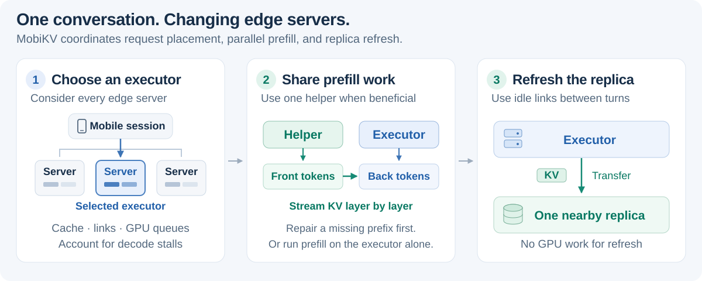

<h1 align="center">MobiKV</h1>

<p align="center">
  <strong>Replica-Assisted KV Cache Scheduling<br>for Multi-Turn LLM Serving at the Mobile Edge</strong>
</p>

<p align="center">
  Wenbin Wang · Runan Wang · Jiangchuan Liu · Xiping Hu
</p>

<p align="center">
  <a href="https://wenbinwang12.github.io/MobiKV/">Project Page</a> ·
  <a href="#highlights">Highlights</a> ·
  <a href="#getting-started">Getting Started</a> ·
  <a href="#documentation">Documentation</a> ·
  <a href="#citation">Citation</a>
</p>

<p align="center">
  <a href="pyproject.toml"></a>
  <a href="LICENSE"></a>
</p>

## Overview

MobiKV schedules multi-turn LLM inference across mobile-edge servers. As users move, the next turn may run on a server that does not hold the conversation's key–value (KV) cache. MobiKV jointly decides **where to execute a turn, how to reuse its cached state, and when a nearby GPU should help with prefill**, accounting for both response latency and interference with ongoing decoding.

This repository contains the research code and evaluation data for MobiKV: a trace-driven simulator, measured A800 cost profiles, GPU measurement and replay programs, and analysis tools.

<p align="center">
  <picture>
    <source media="(max-width: 600px)" srcset="docs/assets/readme-overview-mobile.svg">
    
  </picture>
</p>

- **Cache-aware routing.** Compare execution sites using their cached state, network costs, GPU queues, and the stalls that new work would cause to decoding.
- **Replica-assisted parallel prefill (RPP).** Split long new input between an executor and one helper. The helper computes the front and streams its KV states layer by layer while the executor computes the back.
- **Background replica refresh.** Keep one nearby replica and update it over idle links between turns. Refresh transfers KV state without GPU recomputation.

## Highlights

<table>
  <tr>
    <th align="center" width="33%">Trace-driven simulation</th>
    <th align="center" width="33%">Real-GPU replay</th>
    <th align="center" width="34%">Parallel prefill</th>
  </tr>
  <tr>
    <td align="center"><h3>27–42%</h3>lower P90 time to first token<br><sub>Six standard-attention models</sub></td>
    <td align="center"><h3>54%</h3>lower P90 time to first token<br><sub>Qwen3-8B on three A800 GPUs</sub></td>
    <td align="center"><h3>1.65–1.89×</h3>prefill speedup<br><sub>One helper across five models</sub></td>
  </tr>
</table>

These results describe different experiments:

- **Simulation:** compared with each model's best baseline using one A800 per server and 10 Gb/s links; mean paired ratios over 20 mobility seeds.
- **Replay:** P90 time to first token falls from **4.83 s to 2.24 s** at a 25% GPU share and 0.93 Gb/s. Median time per output token is 33.9 ms, compared with 33.6 ms for the best baseline.
- **Prefill:** the speedup range covers 21 configurations with at least 4k new tokens and a transfer-to-compute ratio below 1. All 510 tested splits match chunked-prefill logits at the same split boundary.

The full evaluation includes **eight models, six baselines, three operating points, six ablations, and a link-rate sweep**. See the [interactive results](https://wenbinwang12.github.io/MobiKV/#analysis), [evaluation protocol](docs/EVALUATION.md), and [released data](docs/data/README.md) for model coverage, confidence intervals, and the scope of each comparison.

## Getting Started

### Installation

The simulator and analysis tools require **Python 3.10+**. They use the included GPU cost profiles and do not require a GPU or model weights.

```bash
git clone https://github.com/WenbinWang12/MobiKV.git
cd MobiKV

python -m venv .venv
source .venv/bin/activate
python -m pip install -e .
```

On Windows PowerShell, activate the environment with `.\.venv\Scripts\Activate.ps1` instead. GPU measurements require a separate CUDA environment; see the [GPU setup and commands](docs/GPU_REPRODUCTION.md).

### Explore the released results

Recompute the full-speed model comparison from the per-seed summaries included in the repository:

```bash
python -m mobikv.analysis.simulation \
  --seeds docs/data/aggregate/simulation_seeds.csv \
  --campaign table_full \
  --out runs/summary
```

This reads existing results without downloading traces or rerunning experiments. It writes `latencies.csv`, `ratios.json`, and `seeds.csv` to `runs/summary/`, including latency percentiles and paired comparisons with 95% confidence intervals. See the [data guide](docs/data/README.md) for units and rounding precision.

### Run a simulation

Obtain the Mooncake request trace and prepare the GeoLife mobility archive using the [input preparation guide](docs/REPRODUCIBILITY.md#input-traces). Then run:

```bash
python scripts/run_mobikv.py \
  --method mobikv --model Qwen3-8B --op full \
  --trace /path/to/mooncake.jsonl \
  --trips /path/to/geolife.npz \
  --seed 41 --out runs/qwen3_mobikv_seed41.json
```

The launcher loads the paper's policy settings and measured costs. Use `--op full` for a whole A800 with 10 Gb/s links, `slow` for a quarter A800 with 0.93 Gb/s links, or `full1g` for a whole A800 with 0.93 Gb/s links. These options select simulated resources. Public traces and model weights are obtained separately from their providers.

## Documentation

| Guide | What you will find |
| --- | --- |
| [Reproducibility](docs/REPRODUCIBILITY.md) | Input preparation, simulator setup, and result aggregation |
| [Experiment commands](docs/EXPERIMENTS.md) | Model comparisons, link-rate sweeps, stress scenarios, and ablations |
| [GPU measurements and replay](docs/GPU_REPRODUCTION.md) | Cost profiling, parallel prefill, and three-server replay |
| [Evaluation protocol](docs/EVALUATION.md) | Models, baselines, workload splits, metrics, and statistical methods |
| [Released data](docs/data/README.md) | Table and figure data, per-seed summaries, units, and checksums |
| [Data sources and references](docs/DATA_RELEASE.md) | Trace downloads, model sources, and baseline papers |

## Repository Structure

```text
mobikv/       Simulator, preprocessing, GPU measurement, and analysis
scripts/      Experiment, measurement, replay, and plotting entry points
configs/      Measured A800 costs and model metadata
docs/data/    Released evaluation summaries and checksums
docs/         Documentation and project website
examples/     Small synthetic examples
tests/        Regression tests
```

## Contributing

Bug reports, documentation improvements, and pull requests are welcome. Use [GitHub Issues](https://github.com/WenbinWang12/MobiKV/issues) for questions or problems. For experiment-related reports, include the command, software environment, model and resource configuration, and relevant error logs so that others can reproduce the issue.

## Citation

If you use MobiKV in your research, please cite the project below. The paper link will be added when the preprint is public.

```bibtex
@misc{wang2026mobikv,
  title  = {MobiKV: Replica-Assisted KV Cache Scheduling for Multi-Turn LLM Serving at the Mobile Edge},
  author = {Wang, Wenbin and Wang, Runan and Liu, Jiangchuan and Hu, Xiping},
  year   = {2026},
  note   = {Preprint forthcoming},
  url    = {https://github.com/WenbinWang12/MobiKV}
}
```

## License

MobiKV is released under the [MIT License](LICENSE). Third-party datasets and model weights are governed by their respective terms; see [data sources](docs/DATA_RELEASE.md) and [third-party notices](THIRD_PARTY_NOTICES.md).
